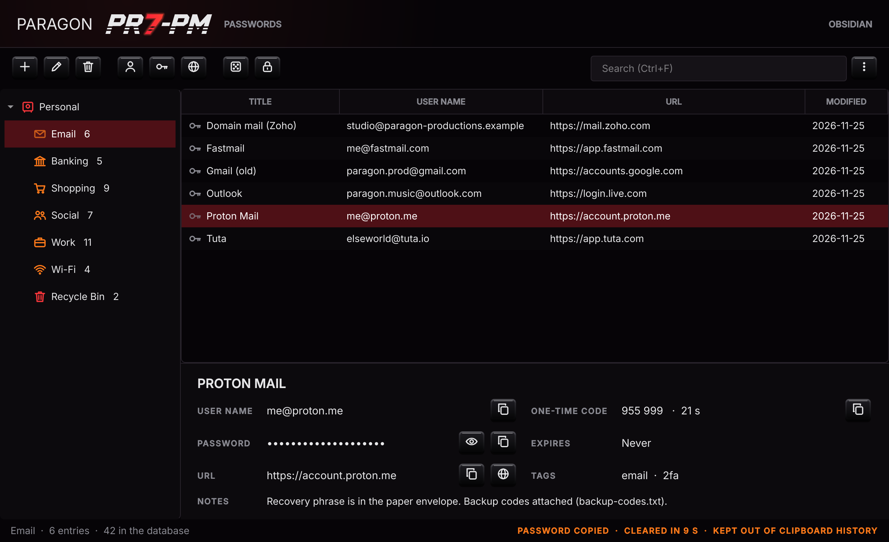
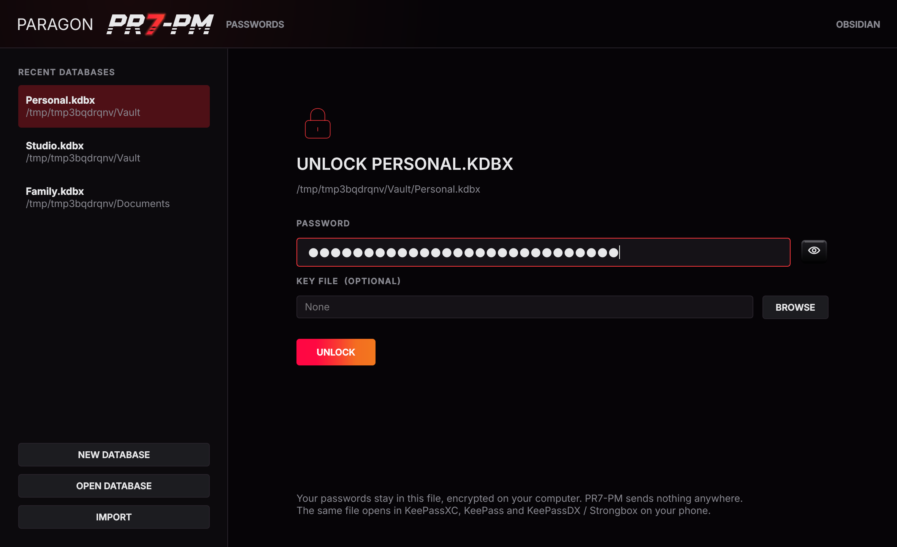

# Paragon PR7-PM

A password manager that works the way **KeePassXC** works, in the Paragon family look (PR7-Z, PR7-W, PR7-L, PR7-F,
PR7-E, PR7-R, PR7-P, PR7-M, PR7-Q, PR7-U, PR7-DU, PR7-CB, PR7-IS). Python and PySide6.

## What it does

- Your passwords live in one encrypted **.kdbx** file (KDBX 4: AES-256, Argon2), KeePassXC's own format: the same
  file opens in KeePassXC, KeePass, and KeePassDX or Strongbox on your phone. Nothing is sent anywhere.
- Groups on the left, entries in the middle, the chosen entry below: user name, password (hidden until you ask),
  URL, one-time 2FA code with its countdown, expiry, tags, notes.
- KeePassXC's keys: **Ctrl+N** new, **Ctrl+E** edit, **Del** delete (to the Recycle Bin, then for good), **Ctrl+B**
  copy user name, **Ctrl+C** copy password, **Ctrl+T** copy one-time code, **Ctrl+U** copy URL, **Ctrl+Shift+U**
  open it, **Ctrl+G** password generator, **Ctrl+L** lock, **Ctrl+F** search (every word, every field but passwords).
- **Copies are private**: marked so PR7-CB, Ditto and Windows' clipboard history (Win+V) never keep them, and
  emptied after 10 seconds.
- **Locks itself** after 5 idle minutes and when Windows locks; locking forgets the open database.
- Every change is saved at once; old values stay in the entry's history.
- Password generator: length, kinds of characters, leave out look-alikes; or passphrases from the EFF word list.
- Import from KeePassXC, Bitwarden, browser or KeePass CSV exports.

## Building

`pip install -r requirements.txt -r requirements-dev.txt`, `python -m pytest`, `pyinstaller pr7pm.spec`, then Inno
Setup 6 on `installer/pr7pm.iss`. CI does all of it on Windows; a pushed new version publishes itself.
